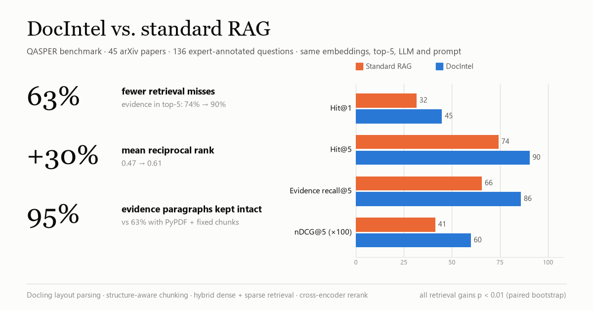

# DocIntel

**Accuracy-first RAG for research papers.** Upload PDFs, ask questions, get answers grounded in the papers with page-level citations.

DocIntel is benchmarked against a standard "chat with your PDF" RAG pipeline on **QASPER**, AllenAI's question-answering benchmark over full-text NLP papers: 45 real arXiv papers (366 pages) and 136 questions with expert-annotated evidence.



| Retrieval, top-5 context (136 questions) | Standard RAG | **DocIntel** | Change |
|---|---|---|---|
| Evidence reaches the LLM (Hit@5) | 74.3% | **90.4%** | +16.2 pts · **63% fewer misses** |
| Evidence ranked #1 (Hit@1) | 31.6% | **44.9%** | +13.2 pts |
| Mean reciprocal rank (MRR@5) | 0.472 | **0.612** | +30% |
| nDCG@5 | 0.414 | **0.599** | +45% |
| Evidence recall@5 | 65.6% | **85.9%** | +20.3 pts |
| Evidence paragraphs kept intact in one chunk | 62.5% | **94.7%** | +32.2 pts |

All retrieval gains are significant (paired bootstrap, p < 0.01). Both systems use the **same embedding model, the same top-5, and the same LLM and prompt**; only the pipeline differs. DocIntel also beats a standard RAG given 2,000-character chunks (85.3% Hit@5) while passing the LLM 19% less text. Full results, ablations and per-question explorer: open the app's **Benchmark** tab, or read [eval/results/RESULTS.md](eval/results/RESULTS.md). The app's **Metrics** tab explains every metric in plain language, with worked examples and an interactive demo.

**End-to-end answers** (50 randomly sampled questions; each pair answered by the same LLM and graded blind against the expert answers):

| | Standard RAG | **DocIntel** |
|---|---|---|
| Judge-scored correctness (partial = ½) | 78.1% | **84.4%** |
| Fully correct | 68.8% | **77.1%** |
| Wrongly says "I don't know" | 6.2% | **0.0%** |
| Head-to-head (48 answerable) | better on 3 | **better on 6** (39 ties) |

The answer-level gap (about +6 pts, p = 0.18) points the same way as the retrieval gains but is not significant at this sample size. It comes from retrieval misses. When standard RAG's top-5 missed the evidence, its answers scored 42% vs DocIntel's 75%. When both found it, they were nearly tied (83% vs 86%), because a strong LLM makes good use of whatever evidence it gets.

---

## How it works

```
PDF ──► Docling layout parsing (reading order, headings, tables)
          │
          ▼
        HybridChunker: section-aware, token-bounded chunks with heading context
        and page provenance
          │
          ├──► dense vectors  (llama-text-embed-v2 or Gemini) ──► Pinecone dense index
          └──► sparse vectors (pinecone-sparse-english-v0)     ──► Pinecone sparse index

Question ──► dense top-30 ┐
         ──► sparse top-30┴─► weighted Reciprocal Rank Fusion ──► cross-encoder rerank ──► top-5
                                                                    (Cohere rerank-v3.5,
                                                                     falls back to bge-reranker-v2-m3)
          ──► Gemini, structured output ──► answer [n] citations · insights · follow-up questions
```

| Stage | Choice | Why |
|---|---|---|
| Parsing | **Docling** (IBM), OCR off, table structure on | PyPDF reads two-column papers in stream order and hyphenates across lines. On QASPER it leaves only 62.5% of evidence paragraphs intact in a chunk; Docling leaves 94.7%. |
| Chunking | **Docling HybridChunker**, 512 tokens, `merge_peers` | Splits on the document's own section structure, so a chunk is a paragraph or section, not an arbitrary 1,000-character window. Heading context is embedded with each chunk. |
| Dense retrieval | Pinecone + `llama-text-embed-v2` (or Gemini embeddings) | Pinecone-hosted embeddings have no daily cap. The Gemini free tier allows 1,000 embedded chunks a day, about 20 papers. |
| Sparse retrieval | Pinecone `pinecone-sparse-english-v0` | Learned lexical matching for model names, dataset names and numbers that dense vectors blur. Stored server-side, so the engine keeps no state in memory. |
| Fusion | Weighted RRF (dense 0.7 / sparse 0.3, k = 60) | Works on ranks, so the two retrievers' incompatible score scales don't matter. |
| Reranking | Cohere `rerank-v3.5` → Pinecone `bge-reranker-v2-m3` → fused order | Cross-encoder over the fused top-30. If Cohere is rate-limited (trial key: 10 calls/min), a second cross-encoder takes over instead of reranking being silently dropped. |
| Generation | Gemini 2.5 Flash, structured output, fallback models | Returns answer, insights and follow-up questions in one call. If the model is rate-limited (free tier: 5 req/min), the next model in `GENERATION_FALLBACK_MODELS` answers, and the response says which. |
| Citations | Numbered context blocks `[n]`, mapped server-side to file + page | Asking the LLM to write `[file, p.X]` produced malformed tags like `[1, p.3]`. Numbers are reliable, and each source in the response is flagged `cited`. |

### What the ablation shows

Each step adds one component (Hit@5 / Hit@1):

| System | Hit@5 | Hit@1 | Context chars |
|---|---|---|---|
| Standard RAG: PyPDF, 1,000-char chunks, dense top-5 | 74.3% | 31.6% | 4,538 |
| Standard RAG, 2,000-char chunks (context-size control) | 85.3% | 40.4% | 8,426 |
| + Docling parsing and structure-aware chunks | 86.8% | 47.8% | 6,451 |
| + Hybrid dense/sparse retrieval | 86.0% | 49.3% | 6,810 |
| **+ Cross-encoder rerank (DocIntel)** | **90.4%** | 44.9% | 6,833 |

- **Parsing and chunking do most of the work.** Most of the gain comes before any retrieval algorithm runs.
- **Hybrid search adds little when the search is scoped to one paper.** Lexical matching matters more across a large multi-document corpus.
- **The reranker trades rank-1 precision for top-5 coverage.** It often promotes the paper's abstract to #1: on topic, but rarely the passage with the answer. Fusing the rerank order with the retrieval order (RRF, no tuning) recovers rank-1 (Hit@1 44.9% → 51.5%, MRR 0.612 → 0.655) at a small cost in coverage (Hit@5 90.4% → 88.2%). None of these differences is significant. The LLM reads all five passages, so plain reranking stays the default and fusion is opt-in (`RERANK_FUSION=1`).

### Cost of accuracy

- Docling parses at **2.3 s/page** on CPU vs 0.04 s/page for PyPDF, so a 10-page paper takes about 25 s to ingest.
- DocIntel's top-5 context is about 50% longer than the 1,000-character baseline (6.8k vs 4.5k characters), because its chunks are whole paragraphs.
- Reranking adds one API call per query.

---

## Running it

```bash
cd backend
python -m venv ../.venv && ../.venv/Scripts/activate      # Windows; use source ../.venv/bin/activate on macOS/Linux
pip install -r requirements.txt
cp .env.example .env                                     # fill in your keys
uvicorn api:app --host 127.0.0.1 --port 8000
```

Then open **http://localhost:8000**. The UI is served by the API.

### Environment

| Variable | Purpose |
|---|---|
| `PINECONE_API_KEY` | Indexes, hosted embeddings, fallback reranker |
| `PINECONE_INDEX_NAME` | Dense index. Auto-created with the right dimension for the provider. |
| `PINECONE_SPARSE_INDEX_NAME` | Sparse index. Create once as `vector_type=sparse`, `metric=dotproduct`. |
| `PINECONE_NAMESPACE` | Optional. Isolates this corpus inside shared indexes. |
| `EMBEDDING_PROVIDER` | `pinecone` (llama-text-embed-v2, the benchmarked setup) or `gemini` |
| `GOOGLE_API_KEY` | Gemini generation (and embeddings if `EMBEDDING_PROVIDER=gemini`) |
| `GENERATION_MODEL`, `GENERATION_FALLBACK_MODELS` | Primary model and comma-separated fallbacks |
| `COHERE_API_KEY` | Primary reranker |
| `RERANK_FUSION` | `1` fuses rerank order with retrieval order: better rank-1, slightly lower top-5. Default off. |

## API

| Method | Endpoint | Description |
|---|---|---|
| `GET` | `/` | Web app |
| `POST` | `/upload` | Multipart PDF: parse, chunk, embed, index. Re-uploading a file replaces its old chunks. |
| `GET` | `/documents` | Indexed documents with pages, chunks and upload time |
| `DELETE` | `/documents/{filename}` | Remove a document and all of its vectors |
| `POST` | `/query` | `{"question": "...", "filenames": ["a.pdf"]?}` → answer, insights, next questions, citations, model, reranker, timings |
| `GET` | `/benchmark` | Benchmark results (`eval/results/summary.json`) |
| `GET` | `/health` | Liveness |

`filenames` scopes retrieval to specific documents with a Pinecone metadata filter. In the UI, tick documents in the library.

---

## Reproducing the benchmark

```bash
python eval/build_dataset.py --papers 45     # QASPER subset + arXiv PDFs
python eval/bench.py ingest                  # PyPDF (1k, 2k) and Docling chunking
python eval/bench.py embed
python eval/bench.py retrieve                # 5 retrieval configs + rank-fusion variant
python eval/bench.py generate                # paired answers, same model per pair
python eval/bench.py judge                   # blinded LLM judge
python eval/bench.py report                  # → eval/results/summary.json, RESULTS.md
```

Every API call is cached in `eval/cache/`, so each stage resumes where it stopped. Generation and judging stop cleanly when a free-tier daily quota runs out; run them again the next day.

**Methodology.** A retrieved chunk counts as relevant if it shares at least half of its word trigrams with a gold evidence paragraph (measured against the smaller of the two), which is fair to any chunking scheme. QASPER's LaTeX placeholders (`BIBREF3`, `INLINEFORM0`) are treated as breaks. A question is kept only if all of its evidence can be located in the real PDF with PyMuPDF, a neutral parser neither pipeline uses. Retrieval is scoped to the paper being asked about, and vector search is exact in-memory search over the same vectors Pinecone stores, so the benchmark never writes to production indexes. CIs are 10,000-sample paired bootstraps over questions.

## What changed from v1

The core pipeline is unchanged. Everything around it is listed in [CHANGES.md](CHANGES.md), with before/after diagrams.


- **Evaluation**: a QASPER benchmark harness with a component ablation, a context-size control, bootstrap CIs, blinded answer judging and a per-question explorer. v1 had no metrics.
- **Citations**: numbered `[n]` citations replace LLM-written `[file, p.X]` tags, which came back malformed. Sources the answer uses are flagged `cited`.
- **Rate limits**: a reranker fallback (Cohere → Pinecone bge), a generation model fallback chain, and an optional no-cap embedding provider.
- **Reranker bias**: optional rank fusion (`RERANK_FUSION`) for the abstract-first bias the benchmark found.
- **Documents**: list and delete endpoints, a per-document query filter, stale-chunk cleanup on re-upload, PDF validation, and a 50 MB limit.
- **Isolation**: optional Pinecone namespace.
- **UI**: rebuilt, served from the API: library with scoping, cited answers with expandable sources, a Benchmark dashboard, and a Metrics page that explains how everything was measured.

## Limitations

- Text PDFs only (OCR is off). Scanned papers need Docling's OCR pipeline.
- Ingestion is synchronous; large batches should go through a job queue.
- Answer-level numbers are a smaller, quota-limited sample than retrieval numbers. See RESULTS.md for sample sizes and judges.

*Built by Shivansh Sharma: [github.com/Shivanshxsharma](https://github.com/Shivanshxsharma)*
